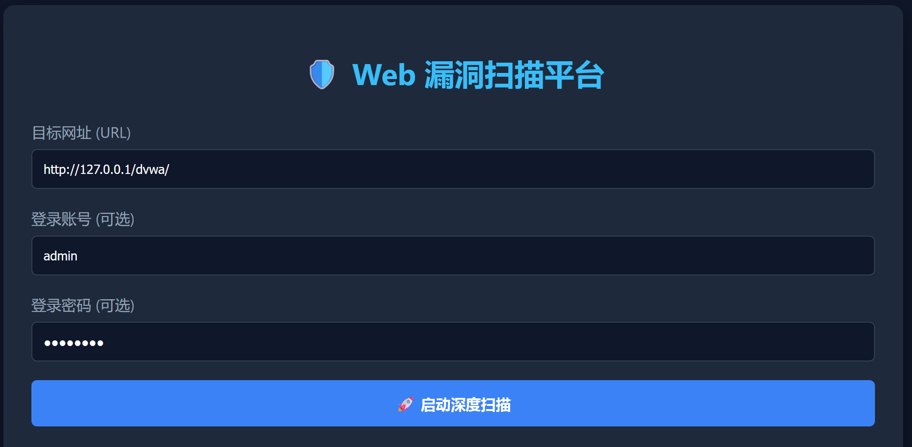
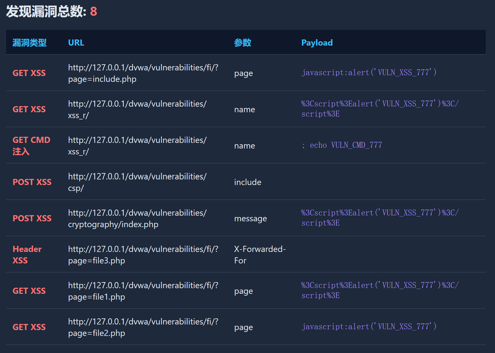

# 🛡️ WebVuln-Scanner: Automated Web Vulnerability Scanning Platform

## 📖 Overview
**WebVuln-Scanner** is a full-stack, automated web vulnerability scanning platform designed for security researchers and penetration testers. Built entirely in **Python** and powered by a **Flask** backend, it provides a sleek, dark-mode web interface for initiating comprehensive security assessments. 

The platform combines a high-concurrency multi-threaded scanning engine with an intelligent asset discovery mechanism, allowing users to perform automated authentication, deep web crawling, and multi-modal vulnerability detection (XSS, SQLi, CMD) seamlessly from a single dashboard.

## ✨ Core Features & Technical Highlights

*   **Full-Stack Web Interface**: A responsive, dark-themed UI built with HTML/JS and served via Flask. Features asynchronous API calls (AJAX/Fetch) to prevent UI blocking during heavy scans.
*   **High-Concurrency Architecture**: Utilizes Python's `ThreadPoolExecutor` for parallel task execution. Integrated with `threading.Semaphore` for rate limiting, effectively preventing target server downtime while maintaining high throughput.
*   **Intelligent Deep Crawler**: Employs `BeautifulSoup4` for rigorous DOM parsing. It automatically extracts hidden form fields, URL parameters, and dynamic links. Includes an exclusion list to prevent infinite loops and avoid crawling destructive endpoints (e.g., `logout.php`).
*   **Multi-Vector Payload Engine**: 
    *   **XSS**: Includes dynamic payload mutation (case-swapping, URL encoding) to bypass basic WAFs.
    *   **SQLi**: Implements time-based blind injection testing with dynamic baseline calibration.
    *   **CMD**: Utilizes signature-based specific markers (e.g., `VULN_CMD_777`) for accurate execution confirmation.
*   **Zero-False-Positive (ZFP) Mechanism (Core Feature)**: Bypasses traditional naive string matching. The engine analyzes the **HTML context** of the injected payload. It distinguishes between an actual vulnerability execution and a harmless "pure-text reflection", ensuring every reported vulnerability has a valid evidence chain.

## 🛠️ Tech Stack

*   **Backend**: Python 3.x, Flask
*   **Networking**: Requests, urllib3
*   **Parsing & Rendering**: BeautifulSoup4, Jinja2
*   **Concurrency**: `concurrent.futures`, `threading.Semaphore`
*   **Frontend**: HTML5, CSS3, Vanilla JavaScript (Fetch API)

## 🚀 Quick Start

1. Clone the repository:
   git clone https://github.com/yourusername/WebVuln-Scanner.git
   cd WebVuln-Scanner

2. Install dependencies:
pip install flask requests beautifulsoup4 fake-useragent jinja2 urllib3

3. Launch the Web Console:
python app.py
(The Flask server will start on http://127.0.0.1:5000)

4. Initiate a Scan:
Open your browser and navigate to the web interface.
Click "Start Deep Scanning" (The default target is pre-configured as local DVWA).

⚙️ Configuration & Customization 
By default, the platform is pre-configured to test the local DVWA (Damn Vulnerable Web Application) environment.
Default URL: http://127.0.0.1/dvwa/
Default Credentials: admin / password

To scan other targets:
Simply modify the Target URL, Username, and Password directly in the Web UI input fields before scanning.
If the new target uses a different login path (not login.php), open scanner.py and navigate to the run_scan_for_web() function to adjust the LOGIN_URL generation logic.

🖼️ Screenshots
1. Interactive Web UI Dashboard

2. Real-time Vulnerability Detection Output

⚠️ Limitations & Future Work 
Please Note: This project is an educational and personal research product, and is not yet a mature, fully-fledged commercial vulnerability scanner.

Dynamic Rendering (SPA): Currently relies on the requests library for HTTP interactions. It may fail to detect DOM-based XSS in modern frontend frameworks (like React/Vue) that require dynamic JS rendering. Future iterations plan to integrate Playwright (Headless Browser) to address this.

WAF Evasion: The current payload mutation engine only supports basic obfuscation (URL encoding, case-swapping). Advanced WAF bypass techniques (e.g., HTML entity encoding, Unicode fuzzing) are planned for future updates.

Architecture: The current implementation is relatively monolithic. Future development will focus on a plugin-based architecture to allow dynamic loading of various vulnerability detection modules.

Despite these limitations, this project serves as a deep dive into multi-threaded concurrency control, automated session management, and context-aware false-positive reduction in web security.

⚠️ Disclaimer
This project is strictly intended for educational purposes and authorized penetration testing only.

As an immature personal project, it may contain bugs or unexpected behaviors. Any unauthorized use of this tool to attack targets without prior mutual consent is strictly illegal. The developer assumes no liability and is not responsible for any misuse or damage caused by this program.