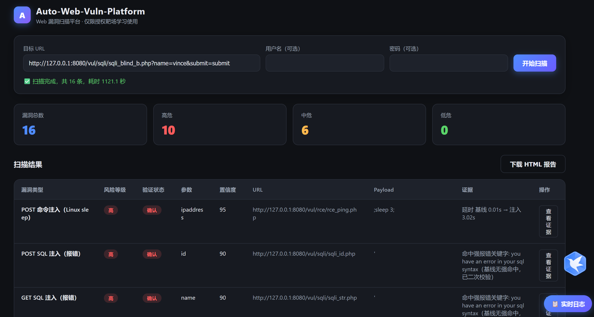

# Auto‑Web‑Vuln‑Platform
[]()
[]()
[]()

> 一款面向授权靶场、自有资产的轻量级Web漏洞扫描工具，用于网络安全学习与工程实践。
> 支持SQL注入（报错 / 时间盲注 / 布尔盲注）、XSS（反射 / 存储 / Header注入）、命令注入检测；
> 具备爬虫降噪、分级任务调度、自适应流控、会话状态感知、多格式结构化报告能力。

## ⚠️ 重要合规声明
本项目**仅可在自有系统或获得书面授权的靶场环境开展安全测试与学习研究**。
依据《中华人民共和国网络安全法》，禁止对未授权业务进行扫描、探测、攻击。
全部操作行为由使用者自行承担法律责任，作者不承担任何相关法律后果。

## ✨ 项目特性
- ✅ **靶场适配能力**：兼容 DVWA、Pikachu；使用种子路径字典补偿，解决普通HTTP爬虫无法解析JS动态导航的缺陷。
- ✅ **SQL注入检测**：报错注入、时间盲注、布尔盲注；引入多维度基线比对机制，实现低误报检测。
- ✅ **XSS检测**：反射XSS、存储XSS、HTTP Header XSS；实现基础DOM上下文识别，判断Payload是否处于可执行上下文。
- ✅ **命令注入**：跨平台Payload适配 Linux / Windows；双轮基线校验，过滤网络抖动带来的误判。
- ✅ **分级任务调度**：轻量任务并发执行，盲注、命令注入等高消耗任务串行执行，规避数据库连接池耗尽风险。
- ✅ **自适应流控**：全局+单域名双层QPS管控、慢请求熔断、动态间隔退让，防止扫描器本身演变为DDoS源。
- ✅ **会话状态感知**：自动识别会话失效、登录过期状态，避免无效探测产生脏检测结果。
- ✅ **风险接口过滤**：默认过滤 DELETE / DROP / RESET 等高风险写类接口，避免对目标产生破坏性操作。
- ✅ **结构化报告**：支持 CSV / HTML / JSON 输出；每条漏洞附带原始请求快照、响应片段、置信等级、OWASP修复建议，具备可复核证据链。
- ✅ **Web可视化控制台**：基于Flask实现，实时流式输出扫描日志，简化操作调试。

## 📋 目录
- [快速开始](#快速开始)
- [项目结构](#项目结构)
- [功能验证](#功能验证)
- [核心实现](#核心实现)
- [设计取舍与权衡](#设计取舍与权衡)
- [已知局限](#已知局限)
- [开发路线图 v1.3](#开发路线图-v13)
- [项目工程思考（面试参考）](#项目工程思考面试参考)
- [License](#license)

## 📸 演示截图

> Web控制台：目标配置、实时扫描、漏洞统计看板、结果表格展示、HTML报告导出功能

## 🚀 快速开始
### 环境依赖
Python >= 3.9
```bash
pip install requests beautifulsoup4 flask
```

### 靶场部署（可选，用于测试）
```bash
# DVWA
docker run -d -p 8081:80 vulnerables/web-dvwa
# Pikachu
docker run -d -p 8080:80 area39/pikachu
```

### 启动项目
```bash
python app.py
```
访问：`[http://127.0.0.1:5000](http://127.0.0.1:5000)`

### 使用说明
Web表单参数：
- 目标 URL：扫描入口地址
- 鉴权方式：`auto` / `cookie` / `bearer` / `none`
- 凭证 / Cookie / Token：需要登录访问的页面（可选）

点击`开始扫描`启动任务。页面会输出实时日志，扫描完成后报告生成在 `reports/` 目录。

## 📁 项目结构
```
Auto‑Web‑Vuln‑Platform/
├── app.py                  # Flask Web UI 入口
├── config.py               # 全局配置：payload、阈值、种子路径、限流参数
├── core/
│   ├── auth.py             # 鉴权模块：Cookie / Bearer / 表单登录
│   ├── crawler.py          # BFS爬虫、链接解析、注入点提取、重负载页面标记
│   ├── detectors.py        # 漏洞检测核心：SQLi / XSS / CMD Injection
│   ├── engine.py           # 扫描调度器：并发控制、限流、会话心跳
│   ├── http_client.py      # HTTP客户端封装：重试、超时、编码、TLS控制
│   ├── reporter.py         # 报告生成器：CSV / HTML / JSON
│   ├── logger.py           # 对接前端的实时日志适配器
│   └── payloads.py         # Payload 集合
├── templates/
│   └── index.html          # 前端页面
├── static/                 # CSS / JS 静态资源
└── reports/                # 扫描报告输出目录
```

## ✅ 功能验证
本项目基于主流开源靶场 **DVWA、Pikachu** 完成完整功能回归验证。
能够覆盖 SQL报错注入、SQL时间盲注、SQL布尔盲注、反射XSS、存储XSS、Header XSS、命令注入、文件包含等典型Web漏洞场景。

> 说明：扫描器以「注入点 + 漏洞类型」生成检测记录；同一个URL参数可被多条检测逻辑同时命中，因此单次扫描输出记录总数会多于靶场实际独立漏洞页面的数量。

## 🧠 核心实现
### 1. 爬虫模块 `crawler.py`
- 使用BFS广度优先遍历；引入**种子路径字典**，弥补普通HTTP爬虫无法解析JS渲染导航的缺陷。
- 过滤静态资源、黑名单路径、高风险写接口。
- 伪404识别：处理靶场场景下HTTP状态码200，但页面资源实际不存在的情况。
- 页面分级：将盲注、命令注入页面标记为重负载任务，执行串行处理。
- 提取URL查询参数、HTML表单输入，作为候选注入点。

### 2. 检测模块 `detectors.py`
- **报错SQL注入**：三重校验：基准响应干净、注入后命中报错特征、二次复现校验，抑制误报。
- **时间盲注SQL**：两次基线采样取最小值消除网络抖动；适配多数据库方言Payload；双条件判定：时间差阈值 + sleep占比约束。
- **布尔盲注SQL**：成对的True/False测试Payload；三项判断指标：响应长度差、特征文本变化、内容相似度；满足至少两项判定为漏洞。
- **XSS检测**：反射/存储/Header XSS；Payload回显校验 + 轻量DOM上下文分析，判断是否进入可执行上下文。
- **命令注入**：跨平台延时Payload；双基线稳定性校验，区分真实命令延时和网络噪声。

### 3. 扫描引擎 `engine.py`
- 分层任务队列：轻量页面在线程池并发运行；重负载检测任务进入串行队列。
- 双层限流：全局QPS + 单主机QPS，避免压垮目标服务器。
- 慢页面熔断：连续多次慢响应后跳过该端点。
- 自适应退让：动态增大请求间隔。
- 会话心跳：定期检测登录状态失效，终止无效扫描流程。

### 4. 报告模块 `reporter.py`
每条漏洞记录包含：漏洞类型、URL、参数、Payload、请求响应证据快照、置信度、风险等级、验证状态、OWASP对齐的修复建议。
三种导出格式：HTML（易读）、JSON（程序二次处理）、CSV（表格审阅）。

## 💡 设计取舍与权衡
### Q：为什么盲注Payload默认不开启？
> 盲注检测请求量大、单请求延迟高，会对后端数据库带来较大压力。
- 报错注入、XSS默认开启。
- 时间盲注 / 布尔盲注由配置项 `ENABLE_BLIND_SQLI` 控制开关。
- 策略：靶场环境打开做完整验证；授权真实资产条件性开启，降低业务影响。

### Q：如何降低误报？
三级防误报机制：
1. 基线对比：干净原始响应与注入后响应对比，只关注Payload带来的差异。
2. 二次复现：高危漏洞必须多次复现才会进入报告。
3. 上下文约束：针对XSS，判断Payload是否落在可执行DOM上下文。
每一条输出漏洞均保留请求响应证据，支持人工复核。

### Q：为什么要区分并发轻任务、串行重任务？
> 已知痛点：多线程同时发送`sleep()`类Payload会打满MySQL连接池，造成大规模超时、扫描雪崩。
> 解决方案：把盲注、命令注入页面隔离到串行队列，避免对数据库层产生并发压力。

### Q：如何处理JS渲染生成的链接？
本扫描器是轻量HTTP爬虫，**不集成无头浏览器**。
靶场场景下采用种子路径字典作为补偿方案。针对复杂SPA业务系统，可以后续集成Playwright迭代优化。

## 📌 已知局限
- 表单自动登录流程尚未完善；复杂登录场景需要手动配置Cookie。
- 在爬虫最大页面数限制下，时间盲注检测可能被截断；建议使用单页面入口测试盲注功能。
- 暂未实现 SSTI / SSRF / XXE / 反序列化检测；当前聚焦SQLi、XSS、命令注入。
- 不支持扫描暂停、断点续扫。
- HTTPS证书校验默认关闭，用于兼容靶场自签名证书。

## 🗺️ 继续优化方向 v1.3
- [ ] 支持`Content‑Type: application/json` JSON请求体注入检测
- [ ] 可配置表单登录：自定义登录URL与登录参数
- [ ] 新增SSTI模板注入检测
- [ ] URL细粒度去重（忽略查询参数顺序差异）
- [ ] 报告内增加漏洞复现步骤
- [ ] 支持扫描暂停与断点续扫

## 💼 项目工程思考
1. **项目定位**：轻量级Web漏洞扫描原型，面向安全学习与授权靶场验证，**不是商用WAF/成熟扫描器**，优先保证可控性、可复核证据链。
2. **核心挑战**
    - 盲注检测：网络抖动造成基线不稳定，极易产生误报；通过**多次采样基线、多条件复合判定、二次复现**降低误报。
    - 稳定性风险：sleep类Payload极易耗尽数据库连接；设计**轻重任务分离串行队列**，从调度层面规避扫描器变成DDoS风险。
    - 爬虫局限：普通HTTP爬虫无法解析JS渲染页面；不引入重型无头浏览器，采用种子路径字典折中适配靶场场景。
3. **降噪思想**：拒绝简单关键词匹配漏洞；全部检测逻辑建立在**干净基线 vs 注入后响应的差异比对**，结合二次校验保证可信度。
4. **风险可控设计**：双层限流、高危接口过滤、盲注功能开关；扫描工具本身必须对目标环境具备保护约束。
5. **工程取舍思维**：Payload不是越多越好，平衡探测效果、请求数量、对目标的压力；不同场景提供开关控制。
6. **验证闭环**：DVWA、Pikachu两套靶场完整回归；每条漏洞留存请求响应快照，支持人工复核，避免黑盒输出不可追溯。

## 📜 License
MIT License

> 仅用于学习研究。扫描任何目标前，请务必获取授权。

如果项目对你有帮助，欢迎Star ⭐，欢迎提交Issue。
